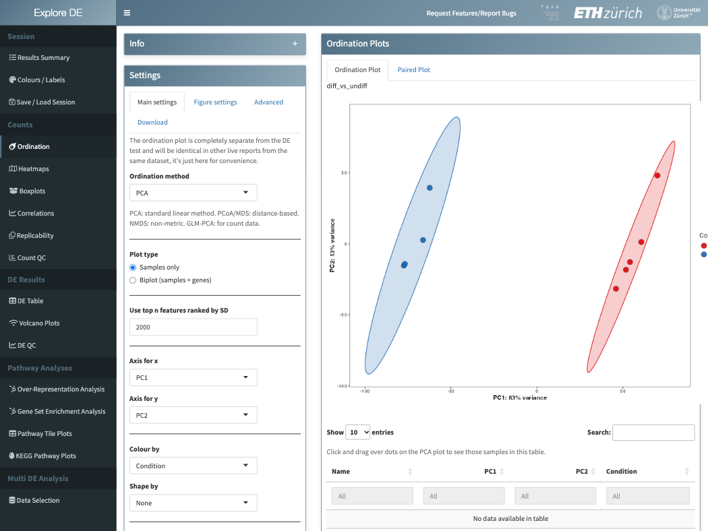
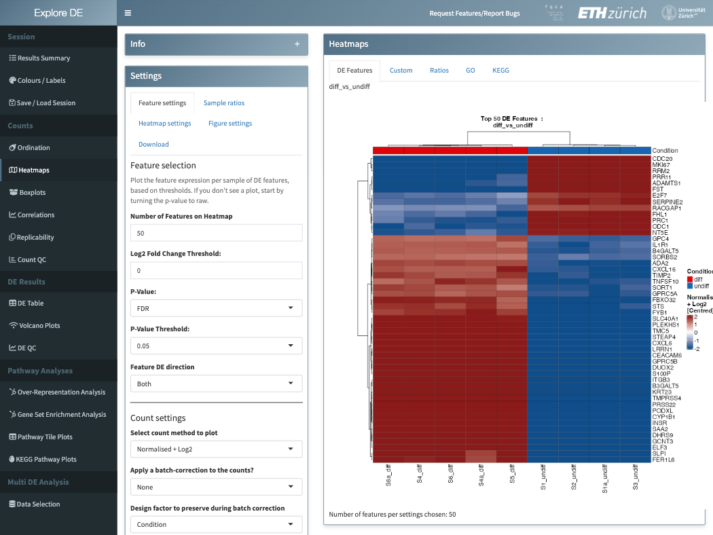
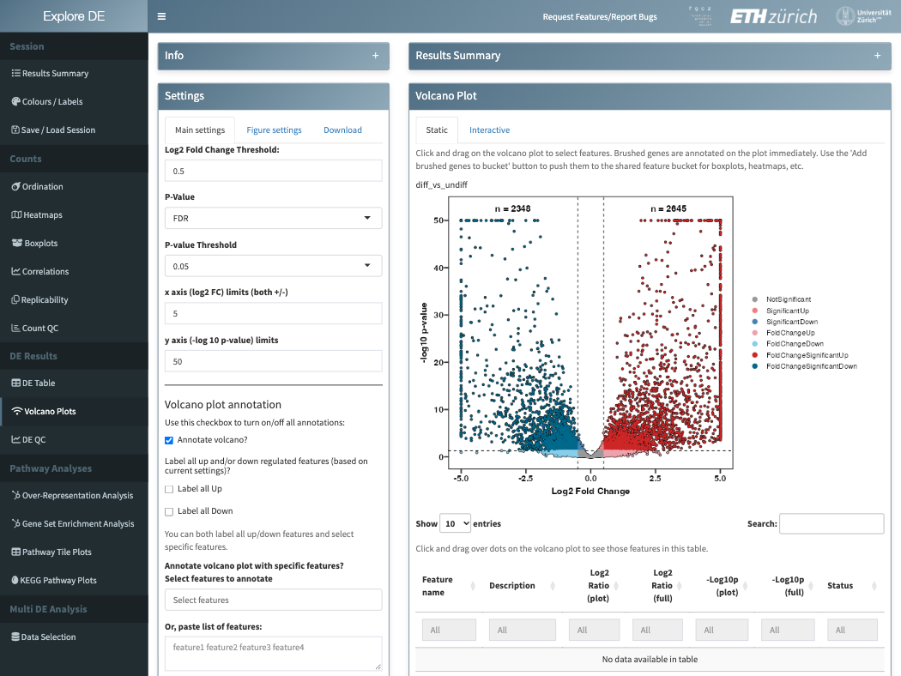

```{r setup, include = FALSE}
knitr::opts_chunk$set(collapse = TRUE, comment = "#>")
```

## Overview

exploreDE is a Shiny app for looking at the results of a differential expression (DE) analysis and turning them into figures. It is written for the person who ran the experiment: the plots are point and click, and figures download as PDF, SVG or PNG, tables as Excel files.

It handles three kinds of data:

- bulk RNA-seq, at gene or transcript level;
- proteomics, at protein, peptide or phosphosite level;
- CRISPR screen guide counts.

It opens:

- an AnnData `.h5ad` file in the exploreDE/1.0 layout. `build_explore_h5ad()` writes one from counts, a sample table, and optionally DE tables (DESeq2, edgeR, limma, prolfqua, SAINTexpress) and clusterProfiler enrichment results;
- the `SummarizedExperiment` results of the FGCZ SUSHI (RNA-seq) and prolfqua (proteomics) pipelines;
- the `AnnData.h5ad` written by the prolfquapp DEA.

This vignette shows how to start the app, what its tabs do, and how to open a dataset in R. The companion vignette `vignette("bring-your-own-data", package = "exploreDE")` explains how to build a file from your own results.

## Installation

```{r install, eval = FALSE}
install.packages("BiocManager")
BiocManager::install("exploreDE")
```

A few features need packages that are only suggested. Without them, the app hides the feature or shows plain text:

```{r install-suggests, eval = FALSE}
BiocManager::install(c(
  "pathview", # KEGG pathway views
  "glmpca", # GLM-PCA ordination
  "ggtext", "gridtext" # formatted group labels (italics, Greek letters)
))
```

## Starting the app

```{r run, eval = FALSE}
library(exploreDE)
exploreDE() # landing page: upload a file, or load the demo dataset
exploreDE("my_data.h5ad") # open a file directly
exploreDE(c("a.h5ad", "b.h5ad")) # compare the contrasts of several files
```

On the landing page, **Load a demo dataset instead** opens the RNA-seq comparison that ships with the package: 9 samples in two groups (`diff`, `undiff`), about 21,000 genes, one DESeq2 contrast, and its GO over-representation and gene set enrichment results. The screenshots below show it.

## A tour of the app

The menu on the left shows only the tabs the loaded data supports:

| Menu group | Tabs | Shown when |
|---|---|---|
| Session | Results Summary, Colours / Labels, Save / Load Session | always |
| Counts | Ordination, Heatmaps, Boxplots, Correlations, Replicability, Count QC | always; Count QC for RNA-seq and CRISPR data |
| DE Results | DE Table, Volcano Plots, DE QC | the dataset has DE results |
| Pathway Analyses | Over-Representation Analysis, Gene Set Enrichment Analysis, Pathway Tile Plots, KEGG Pathway Plots | RNA-seq with DE results; tiles need GO annotation or a KEGG organism; KEGG needs human, mouse or rat |
| Multi DE Analysis | Data Selection, Integrated DE Table, Multi-Contrast Boxplots, Upset/Venn Plots, DE Tile Plots, and pathway bubble plots and heatmaps for RNA-seq | contrasts are loaded in Data Selection |

Every tab has its settings on the left and the figure on the right; the figure's size, fonts and download format are under **Figure settings** or **Download**. Two things are shared across tabs:

- **Feature bucket.** Features picked in one place go into one list: rows of the DE table, points brushed in the volcano plot, a pasted list of names, or a name pattern such as `Hsp*`. The boxplots, heatmaps and tile plots read that list.
- **Colours and labels.** Group colours and display labels are set once, in Colours / Labels, and apply to every figure.

**Ordination** shows the samples on their first principal components (PCA), or with PCoA, NMDS or GLM-PCA, coloured and shaped by the sample factors:

```{r fig-ordination, echo = FALSE, out.width = "100%", fig.alt = "The Ordination tab: settings on the left, a PCA plot of the demo samples on the right, with the two conditions in separate ellipses."}

```

**Heatmaps** shows the counts of the top DE features, a custom feature list, sample ratios, or the genes of a GO term or KEGG pathway. Counts can be variance-stabilised, centred or batch-corrected first:

```{r fig-heatmap, echo = FALSE, out.width = "100%", fig.alt = "The Heatmaps tab: the 50 most significant genes of the demo contrast, clustered, with the condition of each sample in a coloured bar above."}

```

**Volcano Plots** shows the log2 fold change against the p-value or FDR of every feature, with an MA plot below. Brushing points lists them in the table below the plot and can add them to the feature bucket:

```{r fig-volcano, echo = FALSE, out.width = "100%", fig.alt = "The Volcano Plots tab: a volcano plot of the demo contrast, with up- and down-regulated genes in red and blue."}

```

**Save / Load Session** downloads the settings of every tab as one `.json` file, which restores them on the same dataset later. The file holds settings only, no data.

## Datasets in R

Every tab reads its data through one interface, an `ExploreDataset` object. `new_explore_dataset()` returns the same object in R, from a file path, a link or a `SummarizedExperiment`. This is useful for checking a file before opening it in the app, or for reusing the numbers the app shows.

```{r eds, message = FALSE}
library(exploreDE)
se <- readRDS(system.file("examples/genomics/deResult.rds", package = "exploreDE"))
eds <- new_explore_dataset(se)
eds
```

The DE table of a contrast has the statistics under fixed names, whatever the pipeline called them: `effect_log2fc`, `score_pvalue` and `score_fdr`.

```{r de}
de <- eds$de("diff_vs_undiff")
top <- de[order(de$score_fdr), c("display_name", "effect_log2fc", "score_fdr")]
head(top)
sum(de$score_fdr < 0.05 & abs(de$effect_log2fc) > 1, na.rm = TRUE)
```

Assays come by canonical name. The app computes `vst`, `fpkm` and `tpm` from the counts when the file does not hold them:

```{r assay}
eds$assay_names()
eds$assay("normalised_log2")[1:3, 1:4]
eds$samples()[, "Condition", drop = FALSE]
```

`validate_explore_dataset()` checks that the dataset is consistent: factors, contrasts, the DE statistics and the assays.

```{r validate}
validate_explore_dataset(eds)
```

A proteomics result from prolfqua opens the same way:

```{r proteomics}
se_prot <- readRDS(system.file("examples/proteomics/SummarizedExperiment.rds", package = "exploreDE"))
new_explore_dataset(se_prot)
```

## Your own data

`build_explore_h5ad()` writes an exploreDE file from any pipeline's results. Here it rebuilds the demo dataset from its parts: counts, the sample table, the gene annotation and the DE table.

```{r build}
library(SummarizedExperiment)
out <- file.path(tempdir(), "demo.h5ad")
build_explore_h5ad(
  x = list(counts = assay(se, "counts"), normalised = assay(se, "xNorm")),
  out = out,
  omics = "rnaseq",
  organism = "Homo sapiens",
  coldata = colData(se),
  rowdata = rowData(se),
  factors = "Condition [Factor]",
  de = list(diff_vs_undiff = rowData(se))
)
new_explore_dataset(out)$contrasts()
```

```{r run-own, eval = FALSE}
exploreDE(out)
```

The column names of the DE table do not need to follow a convention: a dictionary recognises the usual names of DESeq2, edgeR, limma, prolfqua and SAINTexpress. `vignette("bring-your-own-data", package = "exploreDE")` covers counts-only files, proteomics, pathway results, organisms without an annotation package, and what to do when a column is not recognised.

## Getting help

- Questions: the Bioconductor support site, <https://support.bioconductor.org>, with the tag `exploreDE`
- Bugs and feature requests: <https://github.com/fgcz/exploreDE/issues>

## Session info

```{r session-info}
sessionInfo()
```
